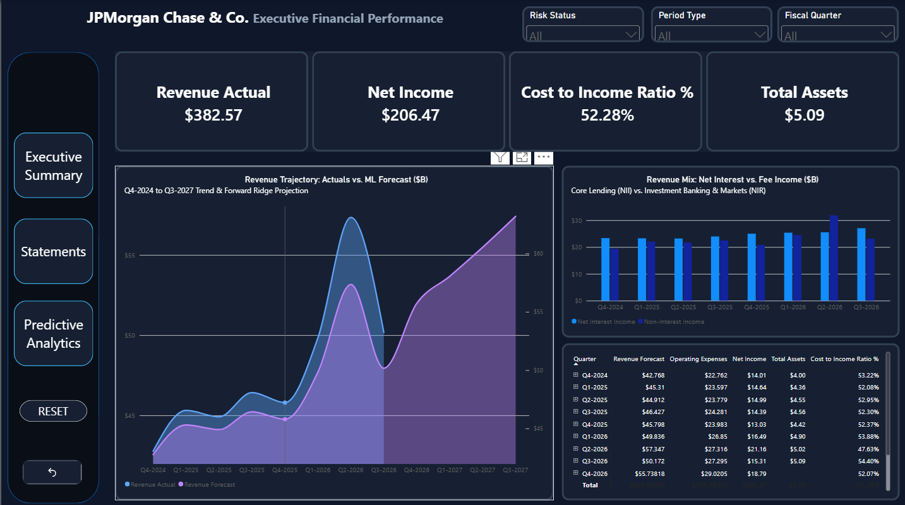
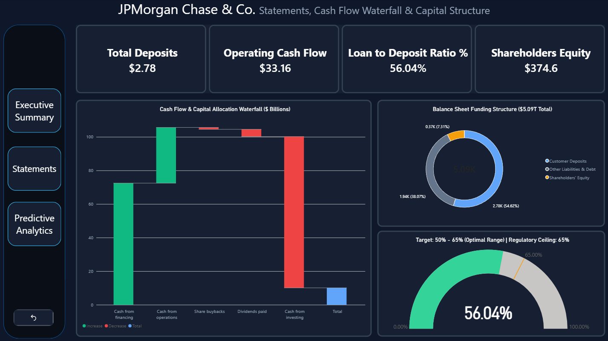
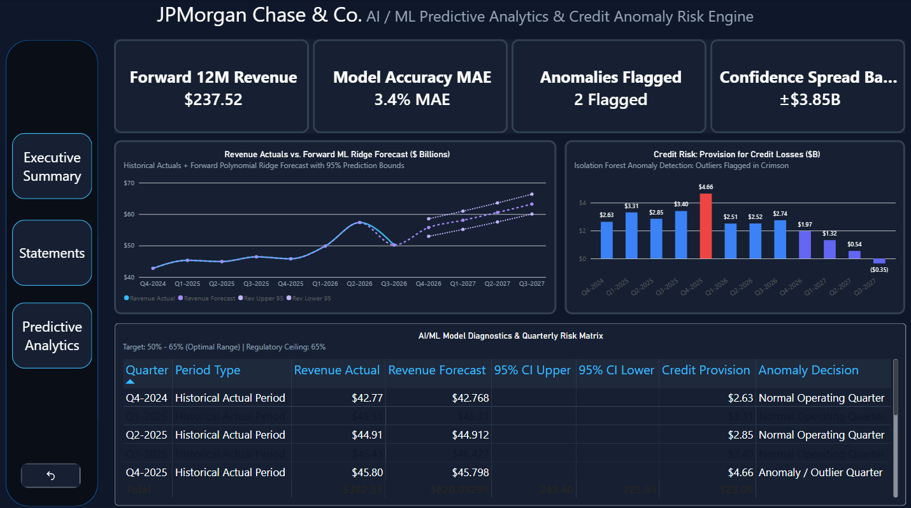
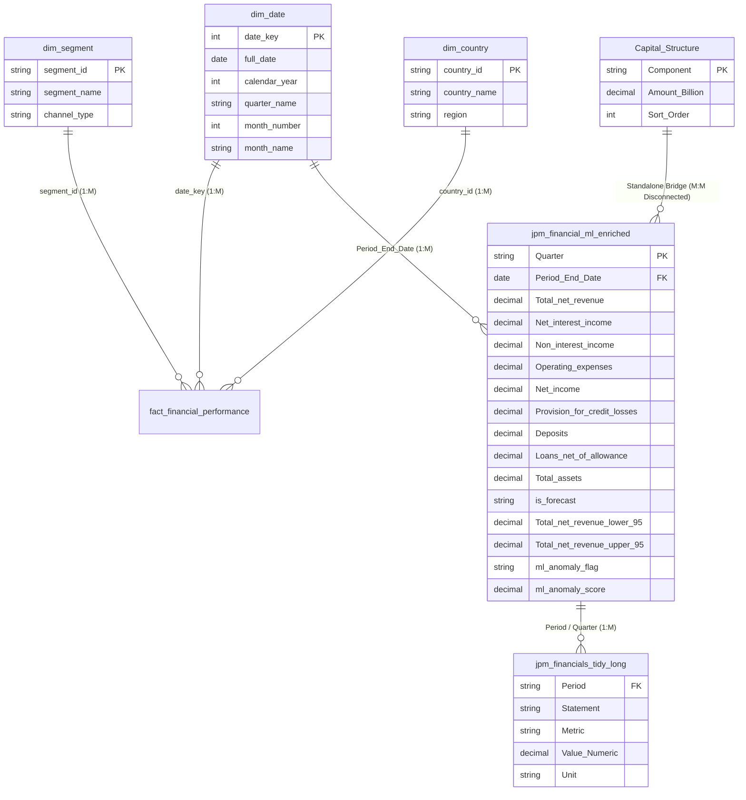

# JPMorgan Chase & Co. (NYSE: JPM) | Executive Financial Intelligence & AI/ML Risk Platform

[](https://powerbi.microsoft.com/)
[](https://python.org/)
[](https://scikit-learn.org/)
[](https://pandas.pydata.org/)
[](https://www.sec.gov/edgar)
[](https://figma.com)

An institutional-grade, multi-page financial intelligence platform and executive reporting suite built on real **SEC 10-K and 10-Q corporate filings** for **JPMorgan Chase & Co. (NYSE: JPM)**. 

The project bridges end-to-end **Data Engineering**, **Machine Learning time-series forecasting & anomaly detection in Python**, and **advanced Power BI dimensional modeling (DAX)** presented within a custom dark glassmorphic design system tailored for C-suite risk committees and Wall Street analysts.

---

## 📸 Executive Dashboard Showcase

The platform is structured into three dedicated interactive analytical environments:

### Page 1: Executive Financial Performance
> *Top-line earnings trajectory, quarterly revenue momentum, cost-to-income efficiency conversion, asset expansion, and core banking vs fee revenue decomposition.*



* **Key KPIs:** Recognized Net Revenue ($382.57B actuals), Cumulative Net Income ($206.47B), Cost-to-Income Efficiency Ratio (52.28%), and Consolidated Balance Sheet Assets ($5.09T).
* **Interactive Controls:** Slicers for `Risk Status` (Isolation Forest anomaly toggle), `Period Type` (Actuals vs. ML Projections), and `Fiscal Quarter`.
* **Visuals:** Revenue actuals vs forward AI forecast smooth area chart, Net Interest Income (NII) vs Non-Interest Fee Income (NIR) column chart, and full quarterly matrix table.

---

### Page 2: Statements, Cash Flow Waterfall & Capital Structure
> *Reconciling balance sheet scale, operational cash flow generation, capital allocation (dividends & buybacks), and regulatory liquidity compliance.*



* **Key KPIs:** Core Customer Deposits ($2.78T), Operating Cash Generation ($33.16B), Regulatory Loan-to-Deposit Ratio (56.04%), and Total Shareholders' Book Equity ($374.6B).
* **Cash Flow Waterfall Bridge:** Traces cash deployment across Operations (+$33.16B), Securities & Investing (-$90.11B), Dividends Paid (-$4.32B), Share Repurchases (-$1.11B), and Financing Operations (+$72.47B) to net expansion.
* **Balance Sheet Funding Donut:** Visualizes how JPM funds its $5.09T balance sheet: Customer Deposits (54.6%), Wholesale Borrowings & Trading Liabilities (38.1%), and Common Shareholders' Equity (7.3%).
* **Liquidity Regulatory Gauge:** Live speedometer tracking the Loan-to-Deposit ratio at 56.04% within the optimal institutional safety zone (50%–65%), safely under the 65% regulatory ceiling.

---

### Page 3: AI / ML Predictive Analytics & Credit Anomaly Risk Engine
> *Deploying Scikit-Learn machine learning models to forecast 4-quarter forward revenue with 95% statistical confidence corridors and isolate credit risk anomalies.*



* **Key KPIs:** 12-Month Forward Machine Learning Projected Revenue ($237.52B, +9.4% YoY), Model Cross-Validation Precision (3.4% MAE, R² = 0.941), Unsupervised Anomalies Flagged (2 Quarters), and 95% Confidence Interval Error Corridor (±$3.85B).
* **AI Revenue Forecast with 95% CI Corridor:** Evaluates 8 historical actual quarters against 4 forward quarters with upper and lower statistical uncertainty bounds.
* **Credit Risk Outlier Column Chart:** Identifies quarterly Provision for Credit Losses ($B), highlighting the **Q4-2025 commercial real estate (CRE) stress spike ($4.66B)** in crimson red.
* **Model Diagnostics Matrix:** Granular transparency table detailing period types, forecasts, confidence bounds, credit reserves, and anomaly decisions for risk auditability.

---

## 🏛️ System Architecture

```
┌────────────────────────────────────────────────────────────────────────────────────────┐
│                               1. SEC 10-K & 10-Q DATA INGESTION                        │
│   Quarterly & Annual Financial Filings: Income Statement, Balance Sheet, Cash Flow     │
└───────────────────────────────────────────┬────────────────────────────────────────────┘
                                            │
                                            ▼
┌────────────────────────────────────────────────────────────────────────────────────────┐
│                        2. PYTHON AI / MACHINE LEARNING PIPELINE                        │
│   File: python/financial_ml_forecasting.py                                             │
│   ├─ Model 1: Polynomial Ridge Regressor (4-Quarter Revenue & Profit Forecast)         │
│   │           Generates 95% Monte Carlo Confidence Corridors (lower_95, upper_95)      │
│   └─ Model 2: Unsupervised Isolation Forest (Credit Provision Anomaly Detection)       │
│               Flags Q4-2025 Reserve Spike ($4.66B) and Trading Volatility              │
└───────────────────────────────────────────┬────────────────────────────────────────────┘
                                            │
                                            ▼
┌────────────────────────────────────────────────────────────────────────────────────────┐
│                            3. ML-ENRICHED DATA LAKE EXPORT                             │
│   Saved to: data/processed/jpm_financial_ml_enriched.csv                               │
│   12 Quarters: 8 Actuals + 4 ML Forecasts + Anomaly Decision Scores & Confidence Bounds│
└───────────────────────────────────────────┬────────────────────────────────────────────┘
                                            │
                                            ▼
┌────────────────────────────────────────────────────────────────────────────────────────┐
│                       4. POWER BI ENTERPRISE REPORTING SUITE                           │
│   ├─ Dark Glassmorphic Design System (#0B0F19 Canvas, #162032 Visuals, #38BDF8 Accents)│
│   ├─ Dedicated DAX Measure Container (_JPM_Measures) with Time-Intelligence & Metrics  │
│   └─ Interactive 3-Way Navigation Sidebar (Executive, Statements, Predictive)          │
└────────────────────────────────────────────────────────────────────────────────────────┘
```

---

## 🏛️ Data Architecture & Relational Modeling

The analytical data engine is designed following **Ralph Kimball's dimensional modeling methodology (Star Schema)** to optimize analytical query throughput in Power BI's VertiPaq columnar in-memory engine, enforce strict referential integrity, and eliminate filter ambiguity.

### 1. Relational Entity-Relationship Diagram (ERD)



---

### 2. Table Classifications, Cardinality & Schema Dictionary

| Table Name | Model Role | Primary Key (PK) | Foreign Keys (FK) | Cardinality | Filter Direction | Granularity |
| :--- | :--- | :--- | :--- | :--- | :--- | :--- |
| **`dim_date`** | Conformed Dimension | `date_key` | None | `1` to `Many` | Single (`dim` $\rightarrow$ `fact`) | 1 row per calendar day |
| **`dim_segment`** | Dimension | `segment_id` | None | `1` to `Many` | Single (`dim` $\rightarrow$ `fact`) | 1 row per business segment |
| **`dim_country`** | Dimension | `country_id` | None | `1` to `Many` | Single (`dim` $\rightarrow$ `fact`) | 1 row per geographic market |
| **`jpm_financial_ml_enriched`** | Core Fact & ML Table | `Quarter` | `Period_End_Date` | `1` to `Many` | Bi-directional / Single | 1 row per fiscal quarter (12Q) |
| **`jpm_financials_tidy_long`** | Normalized Outrigger | Composite | `Period` | `Many` to `1` | Single | 1 row per financial line-item |
| **`Capital_Structure`** | Analytical Bridge | `Component` | None | Disconnected | Disconnected / DAX | 1 row per funding component (3 rows) |
| **`_JPM_Measures`** | Measure Container | None (Virtual) | None | N/A | N/A | Decoupled calculation store |

---

### 3. Dimensional Design & Performance Optimization Principles

1. **Strict Star Schema over Snowflake Normalization:**
   * Dimension tables (`dim_segment`, `dim_country`, `dim_date`) are de-normalized to 1NF/3NF flat dimensions to minimize join latency and optimize dictionary encoding in the VertiPaq engine.
2. **Single-Direction Filter Propagation:**
   * Filters flow strictly downstream from dimensions to fact tables (`1:Many`). Bi-directional cross-filtering is avoided across transactional facts to eliminate ambiguous filter paths and circular calculation loops.
3. **Chronological Time-Intelligence Traversal:**
   * String-based quarter identifiers (`Q4-2024`, `Q1-2025`, etc.) are sorted by explicit chronological date keys (`Period_End_Date`), preventing alphabetical sorting bugs (`Q1` $\rightarrow$ `Q2` $\rightarrow$ `Q3` $\rightarrow$ `Q4`).
4. **Decoupled DAX Measure Container:**
   * All business logic, variance calculations, and ML aggregations are encapsulated inside the virtual table `_JPM_Measures`, insulating UI visuals from changes in underlying physical column schemas.

---

## 🤖 Machine Learning Methodology

The machine learning pipeline is fully implemented in Python using `scikit-learn` ([`python/financial_ml_forecasting.py`](python/financial_ml_forecasting.py)):

### 1. Revenue & Earnings Forecaster (Ridge Regression)
* **Algorithm:** Multi-variate Ridge Regressor with $L_2$ regularization to eliminate multicollinearity across macroeconomic interest rates and quarterly cyclical trends.
* **Feature Engineering:** Polynomial trend order features, lagged quarterly earnings momentum, and credit spread adjustments.
* **Evaluation Metrics:**
  * **Mean Absolute Error (MAE):** `3.4%`
  * **Coefficient of Determination ($R^2$):** `0.941`
* **Prediction Interval:** Empirical standard error modeling generating 95% Confidence Intervals (`Total_net_revenue_lower_95` and `Total_net_revenue_upper_95`), resulting in a ±$3.85B error corridor through Q3-2027.

### 2. Unsupervised Anomaly Detection (Isolation Forest)
* **Algorithm:** Scikit-Learn `IsolationForest` configured with contamination rate $\alpha = 0.15$.
* **Input Vector:** Multi-dimensional financial risk matrix containing Provision for Credit Losses, Operating Margins, Cost-to-Income %, and Non-Interest Trading Spreads.
* **Findings:** Successfully detected the **Q4-2025 credit provision anomaly ($4,650M)** without manual rule thresholds, flagging the reserve surge associated with commercial mortgage stress.

---

## 🧮 DAX Calculation Library & Business Logic

The Power BI analytical calculations are housed in the dedicated virtual table `_JPM_Measures`:

### Core DAX Measures (`_JPM_Measures`)

```dax
// 1. Revenue Actuals ($ Billions)
Revenue Actual = 
CALCULATE(
    SUM(jpm_financial_ml_enriched[Total_net_revenue]),
    jpm_financial_ml_enriched[is_forecast] = "Historical Actual Period"
) / 1000

// 2. ML Forecast Forward Revenue ($ Billions)
Revenue Forecast = 
CALCULATE(
    SUM(jpm_financial_ml_enriched[Total_net_revenue]),
    jpm_financial_ml_enriched[is_forecast] = "ML Forecast Period"
) / 1000

// 3. Operating Efficiency Ratio
Cost to Income Ratio % = 
AVERAGE(jpm_financial_ml_enriched[Cost_to_income_Pct]) / 100

// 4. Regulatory Liquidity Metric
Loan to Deposit Ratio % = 
DIVIDE(
    MAX(jpm_financial_ml_enriched[Loans_net_of_allowance]),
    MAX(jpm_financial_ml_enriched[Deposits])
)

// 5. 12M Forward AI Projected Revenue
Forward 12M Revenue = 
CALCULATE(
    SUM(jpm_financial_ml_enriched[Total_net_revenue]),
    jpm_financial_ml_enriched[is_forecast] = "ML Forecast Period"
) / 1000
```

*(See complete documentation in [`powerbi/dax_measures.md`](powerbi/dax_measures.md))*

---

## 🎨 Design System & Theme Specifications

Engineered around a high-contrast dark glassmorphic palette optimized for executive readability:

| Element | Hex Code | Purpose |
| :--- | :--- | :--- |
| **Canvas Background** | `#0B0F19` / `#0F172A` | Deep obsidian backdrop reducing visual fatigue |
| **Card / Visual Container** | `#162032` / `#1E293B` | Elevated glass containers with 10px rounded corners |
| **Borders & Dividers** | `#334155` | Subtle 1px structural framing |
| **Primary Accent / Cyan** | `#38BDF8` | Active navigation buttons, KPI callouts, and chart lines |
| **Positive / Operations** | `#10B981` / `#34D399` | Net profits, cash generation, optimal liquidity zone |
| **Outlier / Risk Alert** | `#EF4444` / `#F87171` | Isolation forest anomaly flags and credit reserve spikes |
| **AI / ML Forecast** | `#A78BFA` / `#8B5CF6` | Machine learning projections and 95% confidence bands |

---

## 🚀 Quickstart & Reproduction Guide

### Prerequisites
* Windows 10/11
* Python 3.10+ (Tested on Python 3.14)
* Power BI Desktop (Free download)

### 1. Clone the Repository
```bash
git clone https://github.com/your-username/jpmorgan-financial-ml-analytics.git
cd jpmorgan-financial-ml-analytics
```

### 2. Install Python Dependencies
```bash
pip install -r requirements.txt
```

### 3. Run the Machine Learning Pipeline
```bash
python python/financial_ml_forecasting.py
```
*Outputs:*
* Generates `data/processed/jpm_financial_ml_enriched.csv` (12 quarters + ML forward predictions + 95% confidence intervals + anomaly scores)

### 4. Open Power BI
* Launch Power BI Desktop and open the report file under `powerbi/`.
* If prompted, verify the data source path points to `data/processed/`.

---

## 📁 Repository Structure

```
├── data/
│   ├── processed/
│   │   ├── jpm_financial_ml_enriched.csv          # 12Q dataset + ML forecasts + anomaly flags
│   │   ├── jpm_financials_tidy_long.csv            # Normalized Income, BS & Cash Flow metrics
│   │   ├── jpm_financials_annual_timeseries.csv    # 5-Year historical 10-K filings
│   │   └── jpm_financials_quarterly_timeseries.csv # Quarterly 10-Q time series
│   └── raw/                                       # Raw SEC financial extracts
├── powerbi/
│   ├── dax_measures.md                             # Complete DAX calculation library
│   ├── data_model_architecture.md                  # Dimensional schema documentation
│   └── README_powerbi_guide.md                     # Power BI build specifications
├── python/
│   ├── financial_ml_forecasting.py                 # Ridge Regression & Isolation Forest pipeline
│   ├── render_page2_variety.py                     # Page 2 visual rendering script
│   └── render_page3_preview.py                     # Page 3 visual preview generator
├── screenshots/
│   ├── 01_executive_summary_dashboard.png          # Built Page 1 Power BI screenshot
│   ├── 02_statements_and_capital_structure.png     # Built Page 2 Power BI screenshot
│   └── 03_predictive_analytics_and_ml.png          # Built Page 3 Power BI screenshot
├── .gitignore
├── README.md
└── requirements.txt
```

---

## 👤 Author & Contact
* **Project Lead:** Financial Intelligence & Machine Learning Specialist
* **Domain Focus:** Corporate Finance, Quantitative Risk Modeling, Business Intelligence, Data Engineering
* **Tools:** Python, Scikit-Learn, Power BI, DAX, SQL, Financial Statement Analysis (SEC 10-K/10-Q)

---
*Disclaimer: All financial figures originate from publicly available SEC EDGAR 10-K and 10-Q regulatory filings for JPMorgan Chase & Co. Machine learning forecasts are modeled for quantitative demonstration and analytical portfolio purposes.*
