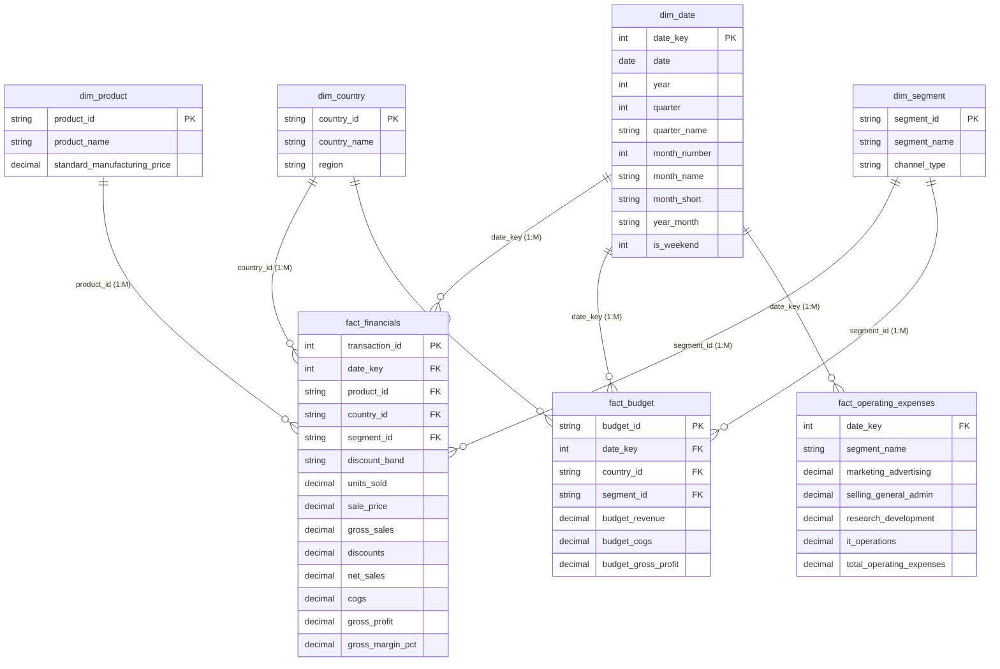

# Power BI Data Model Architecture & Star Schema Design
**Project:** Financial Performance & Profitability Analysis  
**Architecture Type:** Enterprise Kimball Star Schema  
**Target BI Tool:** Microsoft Power BI Desktop / Power BI Service  

---

## 1. Architectural Overview & Star Schema Diagram

The data model is engineered following Kimball dimensional modeling best practices to optimize query performance, simplify DAX measure calculation, and prevent ambiguity in filter propagation.

---

## 2. Table Classifications & Cardinality

| Table Name | Role | Primary Key | Foreign Keys | Granularity | Cross-Filter Direction |
| :--- | :--- | :--- | :--- | :--- | :--- |
| **`dim_date`** | Conformed Dimension | `date_key` | None | 1 Row per Calendar Day | Single (`1` to `*`) |
| **`dim_product`** | Dimension | `product_id` | None | 1 Row per Commercial Product Line | Single (`1` to `*`) |
| **`dim_country`** | Dimension | `country_id` | None | 1 Row per Global Market Country | Single (`1` to `*`) |
| **`dim_segment`** | Dimension | `segment_id` | None | 1 Row per Customer Market Segment | Single (`1` to `*`) |
| **`fact_financials`** | Core Fact | `transaction_id` | `date_key`, `product_id`, `country_id`, `segment_id` | 1 Row per Commercial Sales Transaction | Target |
| **`fact_budget`** | Illustrative Target Fact | `budget_id` | `date_key`, `country_id`, `segment_id` | 1 Row per Month × Country × Segment | Target |
| **`fact_operating_expenses`** | Illustrative Cost Fact | Composite (`date_key`, `segment_name`) | `date_key` | 1 Row per Month × Segment | Target |

---

## 3. Data Modeling Principles & Optimization Rules

1. **Strict 1-to-Many Relationships with Single-Direction Filtering:**
   - All relationships originate from the **1-side** (Dimension tables) and propagate to the **Many-side** (`fact_financials` / `fact_budget`).
   - Bidirectional cross-filtering is strictly disabled to avoid circular dependencies and unexpected filter context inflation.
2. **Dedicated Date Dimension:**
   - Auto Date/Time in Power BI Desktop options is disabled to reduce file size and ensure precise time-intelligence calculations (`SAMEPERIODLASTYEAR`, `TOTALYTD`).
   - `month_name` is explicitly set to sort by `month_number`.
   - `quarter_name` is set to sort by `quarter`.
3. **Dedicated Measure Table:**
   - All DAX calculations reside in `_Financial_Measures`. No naked aggregations (e.g. dragging raw numeric columns into visuals) are used.
4. **Hiding Foreign Keys:**
   - Key columns in the fact tables (`date_key`, `product_id`, `country_id`, `segment_id`) are hidden from the Report View to prevent end-users from accidentally aggregating keys or slicing from fact attributes.
5. **Separation of Actuals vs Simulated Models:**
   - Actual operational results reside in `fact_financials`.
   - Budget targets reside in `fact_budget`.
   - Operating expense line-items reside in `fact_operating_expenses`.
   - Measures combine these seamlessly in DAX (`[Total Revenue] - [Budget Revenue]`).
